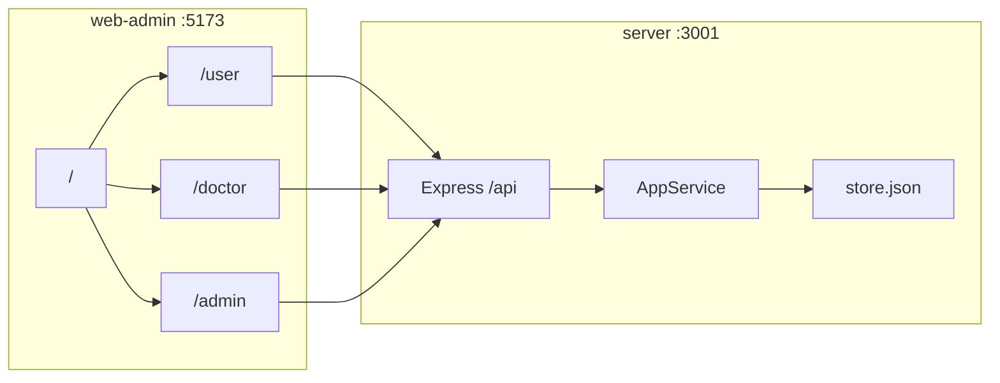

# 架构设计

## 概述

检后无忧把体检中心、基层医生、体检用户放在同一条数据链上。管理端导入报告、上架套餐、配置号源和医生账号；用户端查看报告、预约体检、AI 解读、咨询医生、打卡和完成复查；医生端处理预警、回复咨询、随访并下发复查提醒。一期无独立数据库，Express 进程内 Map + `server/data/store.json` 落盘。

效果：身份证匹配后用户立刻看到报告；异常按阈值出现在医生预警；用户预约占用全局号源；医生下发的复查提醒出现在用户首页。

## 技术栈

**语言与运行时**

- TypeScript / Node.js（后端 `tsx src/main.ts`）
- JavaScript + Vue 3（`web-admin` 三端合一）

**框架**

- 后端：Express 直挂原 Nest 风格 `AppController` / `AppService`（tsx 下 Nest DI 不可用）
- 前端：Vue 3 + Vue Router + Element Plus + Vite
- 测试：`tsx --test src/**/*.spec.ts`

**数据存储**

- 内存 Map/Array（`server/src/store.ts`）
- 文件：`server/data/store.json`
- 敏感字段 AES-GCM 加密存储，接口返回脱敏

**基础设施**

- 预览：Vite 5173 反代 `/api` → `127.0.0.1:3001`
- `allowedHosts` 含 `.monkeycode-ai.online`

## 项目结构

```
/workspace
├── server/                 # API，端口 3001
│   ├── src/main.ts         # Express 路由
│   ├── src/app.controller.ts
│   ├── src/app.service.ts
│   ├── src/store.ts
│   └── data/store.json     # gitignore
├── web-admin/              # C 端 + 医生端 + 管理端，端口 5173
│   └── src/views/user|doctor| 管理端页面
├── web-doctor/             # 医生独立工程，端口 5174，非预览默认
├── packages/shared/        # 枚举、校验
├── miniprogram/            # 早期小程序草稿，门户以 web-admin 为准
└── .monkeycode/docs/       # 本文档
```

**入口点**

- `server/src/main.ts`
- `web-admin/src/router.js`
- `web-admin/src/views/portal/Home.vue`

## 子系统

### 存储与鉴权

**位置**: `server/src/store.ts`, `server/src/common/jwt.ts`, `crypto.ts`

用户/员工 JWT 分三套 token。员工停用（`staff.status=disabled`）后 `staffLogin` 拒绝。

### 套餐预约与号源

**位置**: `app.service.ts` 中 packages/appointments；管理端 Packages / AppointmentSettings / Appointments；C 端 Packages / PackageDetail / Booking / Appointments

全局时段池，容量 × 时段 = 单日上限。

### 报告导入与预警

**位置**: 导入/FHIR 接口；管理端 Imports、Fhir、AlertRules；C 端 Reports；医生端 Alerts、Record

身份证匹配用户；阈值只作用于新导入。

### 咨询与 AI

**位置**: consultations/messages；`/reports/:id/interpret|ask|chats`

AI 无 LLM 时规则解读；咨询 4 秒轮询。

### 随访与复查

随访是医生任务；复查提醒是给用户的待办。两条链都从患者档案出发。

## 架构图



页面级关联见 当前工作区 `/.monkeycode/docs/专有概念/页面职责与三端关联.md`。
