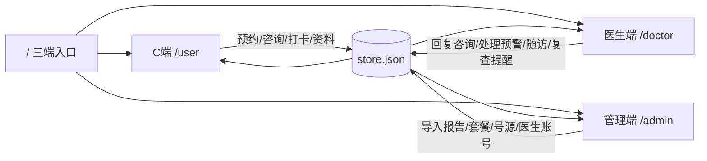

# 页面职责与三端关联

本文按代码里真实存在的路由写：每个页面干什么、数据从哪来、改完会在哪些端立刻看见。路径以 `web-admin` 三端合一门户为准（预览口 5173）。

三端共用同一份内存 + `server/data/store.json`。没有独立数据库。

---

## 总览：业务怎么串起来

| 业务链 | 起点页面 | 中间页面 | 终点页面 |
| :--- | :--- | :--- | :--- |
| 检前预约 | 管理端套餐管理、号源设置 | C 端套餐列表 → 详情 → 确认预约 | C 端我的预约；管理端预约管理、用户管理 |
| 检中体检 | 管理端数据导入 / FHIR | 身份证匹配已注册用户 | C 端报告列表；医生端患者档案、预警中心 |
| 检后解读 | C 端报告详情 | C 端 AI 解读 | 医生端咨询工作台（用户转人工） |
| 检后干预 | 医生端预警中心 / 患者档案 | 随访任务、复查提醒、宣教 | C 端复查提醒、健康打卡、我的 |
| 账号与权限 | 管理端医生管理、角色权限 | 医生端个人设置 | C 端咨询里看到的医生姓名/职称 |

---

## 门户

### `/` 三端入口 `views/portal/Home.vue`

干什么：选身份。不登录、不调业务接口。

和其它页：跳到 `/user/login`、`/doctor/login`、`/admin/login`。各端退出后也回到这里。

---

## C 端（用户）

壳：`/user` → `views/user/Layout.vue`。底栏四 tab：首页、预约、报告、我的。深页（报告详情、套餐详情、预约确认、AI、咨询、风险、打卡、复查、编辑资料、咨询记录）藏底栏。

未登录一律去 `/user/login`。token：`jh_user_token`。

### `/user/login` 登录/注册 `Auth.vue`

干什么：手机号+密码登录；注册时填昵称、年龄、性别、真实姓名、身份证。身份证用来匹配管理端已导入的报告，并自动签约默认医生。

和其它页：

- 成功 → `/user/home`
- 注册成功后，管理端「用户与推送」立刻多一条；医生端「签约患者」立刻多一人
- 身份证对上后，C 端「报告」出现对应报告；医生端患者档案、预警中心同步出现异常项

### `/user/home` 首页 `Home.vue`

干什么：健康概览（最近报告、风险、异常数）+ 7 宫格入口 + 待复查 + 套餐卡片 + 近期报告。

和其它页：

- 宫格：预约、报告、AI 解读、在线咨询、健康打卡、复查提醒、风险评估
- 待复查卡片 → `/user/reminders`（数据来自医生在患者档案里下发的提醒）
- 套餐卡片 → `/user/packages/:id`（数据来自管理端上架套餐）
- 最近报告 → `/user/reports/:id`（数据来自管理端导入）

### `/user/packages` 体检套餐列表 `Packages.vue`

干什么：展示上架套餐，顶部显示「今日可约人数」。号源是全局池，所有套餐共用。

和其它页：

- 数据来自管理端「套餐管理」上架记录 + 「号源设置」的时段/容量/停约日
- 点套餐 → `/user/packages/:id`
- 「我的」→ `/user/appointments`

管理端把套餐下架或把当天加入停约，这个列表立刻变。

### `/user/packages/:id` 套餐详情 `PackageDetail.vue`

干什么：看项目、价格、须知；选日期和时段；看该日余号。点「确认预约」不直接下单，先去确认页。

和其它页：

- 项目来自管理端套餐勾选的指标库
- 余号来自号源设置 × 已有预约
- 下一步 → `/user/booking/:id?date=&slot=`

### `/user/booking/:id` 预约确认 `Booking.vue`

干什么：复核套餐、日期、时段、体检人（姓名/手机/身份证脱敏）。真正调用 `POST /appointments`。

和其它页：

- 体检人来自「编辑资料」和注册实名
- 成功 → `/user/appointments`
- 同时出现在管理端「预约管理」，并占用号源（C 端其它人看到余号减少）
- 用户管理里该用户的「已约套餐」更新

满号、停约、套餐下架会失败，提示回详情页换日期。

### `/user/appointments` 我的预约 `Appointments.vue`

干什么：看自己的预约，可取消。取消后号源释放。

和其它页：管理端预约管理同步变成「已取消」；列表页「今日可约」加 1。

### `/user/reports` 报告列表 `Reports.vue`

干什么：时间线列出本人报告，支持分页。报告由管理端导入或 FHIR 写入，按身份证匹配。

和其它页：点进 `/user/reports/:id`；顶栏「AI 解读」→ `/user/ai`。医生端患者档案看到同一批报告。

### `/user/reports/:id` 报告详情 `ReportDetail.vue`

干什么：逐项指标、异常高亮、本页可生成整体解读或点指标追问；也可跳进 AI 对话或咨询医生。

和其它页：

- 异常指标在导入时已按管理端「预警阈值」生成医生端预警
- 「进入 AI 对话」→ `/user/ai/:id`
- 「咨询签约医生」→ `/user/consult`，消息出现在医生端咨询工作台

### `/user/ai` 与 `/user/ai/:id` AI 解读 `AiChat.vue`

干什么：针对某份报告做整体解读和追问，带历史记录。无 LLM 时走规则解读，每条回答带免责声明。追问日限 10 次。

和其它页：报告来自导入；解决不了可去咨询页找真人医生。管理端不展示对话内容。

### `/user/risk` 健康风险评估 `Risk.vue`

干什么：慢病分层 + ECharts 五维雷达 + 按分层跳转。「查看详细建议」带着最高维风险问句进入 AI 解读。模型版本号和五维权重来自管理端「评估模型」。

和其它页：分数来自本人最新报告指标 × 管理端权重。医生端患者列表的低/中/高来自报告异常项数，不是这一页的慢病模型。咨询入口进医生咨询工作台；预约入口进套餐列表。

### `/user/consults` 咨询记录 `ConsultHistory.vue`

干什么：会话列表，显示医生名、最后一句、待回复/已回复。可发起新会话。

和其它页：点进 `/user/consult/:id`。医生端咨询工作台是同一批会话的另一面。医生在「个人设置」改的姓名会出现在这里。

### `/user/consult` 与 `/user/consult/:id` 在线咨询 `Consult.vue`

干什么：和签约医生发文字，4 秒轮询。

和其它页：

- 医生在咨询工作台回复后，气泡出现在这里
- 可从报告详情、首页宫格、咨询记录进来
- 医生侧可跳该患者档案

### `/user/health` 健康打卡 `Health.vue`

干什么：血压（收缩/舒张）、血糖、体重、步数打卡，折线趋势图。SBP > 180 给就医提示，并生成医生端未处理预警（指标名「收缩压」）。

和其它页：记录进健康时间线，医生在患者档案能看到。危急值进预警中心和工作台「危急打卡」。页内可跳咨询。打卡本身不自动完成复查提醒。

### `/user/reminders` 复查提醒 `Reminders.vue`

干什么：看医生下发的待复查，可「已复查」或去预约复查。

和其它页：

- 数据来自医生在患者档案点「设置复查提醒」
- 「预约复查」→ `/user/packages`
- 标记完成后医生仍能在提醒列表接口看到 done 状态

### `/user/mine` 个人中心 `Mine.vue`

干什么：资料摘要 + 功能入口 + 医生宣教阅读。

和其它页：编辑资料、报告、预约、复查、风险、打卡、咨询记录、AI。宣教来自医生端「健康宣教」，阅读会计数。

### `/user/edit` 编辑资料 `ProfileEdit.vue`

干什么：改昵称、性别、年龄、既往史、过敏史。手机号只展示。实名在登录/注册完成。

和其它页：预约确认页用姓名/手机；医生档案用既往史/过敏史；管理端用户表用姓名/昵称筛选。

---

## 医生端

壳：`/doctor` → `views/doctor/Layout.vue`。侧栏：工作台、患者列表、预警中心、咨询工作台、随访任务、健康宣教、个人设置。

token：`jh_doctor_token`。管理端把医生停用后，本账号无法再登录。

### `/doctor/login` 登录 `doctor/Auth.vue`

干什么：账号密码登录（`POST /auth/staff`，`expectRole=doctor`）。也保留注册入口。

和其它页：账号由管理端「医生管理」创建。成功 → `/doctor/home`。

### `/doctor/home` 工作台 `Dashboard.vue`

干什么：问候语 + 四张数字卡（签约患者、待回复、待随访、今日预警）+ 具名待办列表 + 近 7 日咨询折线。

和其它页：数字来自 C 端注册/发消息/血压打卡、管理端导入触发预警、本端随访是否过期、已下发未完成的复查提醒。

### `/doctor/patients` 患者列表 `Patients.vue`

干什么：看挂在自己名下的用户，按姓名/手机、风险筛，按风险优先排。

和其它页：

- 人来自 C 端注册（自动签约默认医生）
- 风险、最近体检、异常数、未处理预警来自导入报告
- 行点击 → 患者档案；也可去咨询、随访

### `/doctor/patients/:id` 患者档案 `Record.vue`

干什么：一个人的完整检后视图——基本信息、既往史过敏史、报告指标、健康时间线；可制定月随访、下发复查提醒。

和其它页：

- 资料来自 C 端注册/编辑资料
- 报告来自管理端导入
- 时间线含打卡、咨询、随访
- 「去咨询」→ 咨询工作台（C 端对应用户发消息）
- 「制定随访」→ 随访任务出现新单
- 「设置复查提醒」→ C 端首页待复查 + 复查提醒页出现一条

### `/doctor/alerts` 预警中心 `Alerts.vue`

干什么：处理导入时按阈值打出来的异常。可标记处理，或直接发起随访。

和其它页：

- 规则来自管理端「预警阈值」（只影响新导入）
- 患者来自报告匹配到的 C 端用户
- 「查看档案」→ 患者档案
- 「发起随访」→ 随访任务

C 端看不到预警工单，只在报告里看到异常指标。

### `/doctor/consult` 咨询工作台 `Consult.vue`

干什么：选会话、回消息、套用饮食/运动处方模板，4 秒刷新。

和其它页：消息来自 C 端咨询页。可跳患者档案。未读数反映到工作台。

### `/doctor/followups` 随访任务 `Followups.vue`

干什么：给签约患者批量建月随访，记录血压和依从性后归档。逾期标红。创建随访时同步给该患者发一条复查提醒。

和其它页：可从预警「发起随访」或档案「制定随访」进来。结果进患者时间线。C 端没有单独随访页，同步生成的提醒出现在首页待复查和复查提醒页。

### `/doctor/edu` 健康宣教 `Edu.vue`

干什么：按分组发文章，看阅读/点赞/评论。

和其它页：发布后出现在 C 端「我的」。和咨询、预警无直接数据耦合。

### `/doctor/settings` 个人设置 `Settings.vue`

干什么：改姓名、职称、医院、科室、电话、擅长；开关咨询/预警/随访通知（一期存档，工作台仍拉实时数据）。

和其它页：姓名出现在 C 端咨询记录。管理端医生管理改同一份 staff 记录。停用只能管理端做。

---

## 管理端

壳：`/admin` → `views/Layout.vue`。

token：`jh_admin_token`。登录：`POST /auth/staff`（管理员角色）。

### `/admin/login` 登录 `Login.vue`

干什么：管理员账号登录。成功 → `/admin`。

### `/admin` 运营总览 `Overview.vue`

干什么：注册用户、报告、咨询、未处理预警等快照，以及最近导入。

和其它页：数字来自全库。快捷去导入、用户、统计。导入一批后这里的报告数、预警数会变。

### `/admin/imports` 数据导入 `Imports.vue`

干什么：下模板、传 Excel/CSV、或导入示例。按身份证匹配用户；匹配到则报告出现在该用户 C 端；异常按预警阈值生成医生端预警。

和其它页：这是检后链路的总闸。导入成功 → C 端报告、医生档案/预警、总览、统计白皮书全部更新。操作写入日志。

### `/admin/fhir` 接口同步 `Fhir.vue`

干什么：模拟 HL7/FHIR 推送，`messageId` 去重，`resumeToken` 续传，可带报告行入库。页内写明会改 C 端报告/风险、医生档案/预警、管理端总览。

和其它页：效果与导入相同，多一条接入通道。重复消息不会再给 C 端多一份报告。

### `/admin/packages` 套餐管理 `Packages.vue`

干什么：增删改套餐，从指标库勾项目，上架/下架。上架才在 C 端预约列表出现。

和其它页：C 端套餐列表/详情/预约确认都读这里。已预约数来自预约表。下架后 C 端看不见，已产生的预约仍在「我的预约」和「预约管理」。

### `/admin/appointments` 预约管理 `Appointments.vue`

干什么：看全部预约（用户、套餐、日期、时段、电话、金额、状态），可按套餐筛。一期只读，取消在 C 端「我的预约」做。

和其它页：数据来自 C 端下单。号源余量随状态变。用户管理的「已约套餐」取最近一条预约。

### `/admin/settings/appointments` 号源设置 `AppointmentSettings.vue`

干什么：配每时段人数、时段列表、停约日期。所有套餐共用。单日上限 = 人数 × 时段数。已取消不占号。

和其它页：C 端列表「今日可约」、详情时段余号、确认下单校验，全部读这份配置。改完立刻生效。

### `/admin/stats` 三端运营白皮书 `Stats.vue`

干什么：体检中心用来回答四件事——有多少人从注册走到问医生、套餐号源有没有人约、导入报告里什么指标在亮、医生有没有接住预警和咨询。按机构筛选后可生成白皮书文案并导出 JSON。数字都能点到对应管理页。

和其它页：

- 漏斗：注册来自 C 端登录页 → 已预约来自 C 端确认预约（管理端预约管理）→ 已有报告来自数据导入按身份证匹配 → 已咨询来自 C 端咨询页 / 医生咨询工作台
- 套餐柱表：管理端套餐管理上架的商品 × C 端下单；取消回写号源设置里的余量
- 异常 TOP：数据导入的指标；改预警阈值只作用于之后新导入，工单在医生端预警中心处理
- 干预 KPI：未处理预警 / 随访 / 待复查提醒 / 医生回复数 / 中高风险未咨询人数；后一项去用户管理筛人推送，或医生从患者列表跟进
- 运营总览是实时快照，本页是可导出的运营解释；总览「打开统计」进入本页

### `/admin/users` 用户与推送 `Users.vue`

干什么：看 C 端注册用户；按姓名/昵称、最近体检日、已约套餐筛；导出 CSV；按当前列表排队推送复查类订阅消息。

和其它页：人来自 C 端注册；体检日/风险来自导入报告；已约套餐来自预约。推送是排队，C 端无独立收件箱。

### `/admin/doctors` 医生管理 `Doctors.vue`

干什么：创建医生账号、改资料、重置密码、停用/启用。停用后医生端登不上。

和其它页：新建的医生可从 `/doctor/login` 登录。资料与医生「个人设置」同一条 staff。C 端咨询展示的医生名来自这里。一期注册用户挂到默认医生；停用后患者分配策略以当前后端实现为准。

### `/admin/rbac` 角色权限 `Rbac.vue`

干什么：维护角色名、父角色、权限标签（`stats:read`、`import:write`、`patient:contracted:read`、`user:push`）。

和其它页：一期登录鉴权按 staff.role（admin/doctor），本页权限标签尚未逐接口强制。给论文/后续扩展用。

### `/admin/logs` 操作日志 `Logs.vue`

干什么：看近 6 个月审计：导入、推送、建医生、改号源等。

和其它页：只读。C 端用户操作不全记（预约取消等以业务表为准）。

### `/admin/settings/alerts` 预警阈值 `AlertRules.vue`

干什么：改指标编码、运算符、阈值、等级。只作用于之后新导入的报告。

和其它页：导入时用新规则生成预警 → 医生预警中心。已存在的预警不会因为改阈值而消失或再生。C 端报告仍显示原始高低标记。

### `/admin/settings/risk-model` 评估模型 `RiskModel.vue`

干什么：保存模型版本号和五维权重。C 端风险页展示版本，并按权重重算分层与雷达。

和其它页：权重立刻作用于 `GET /risk/me`。报告列表/患者列表上的低/中/高来自报告 `riskLevel`（异常项数），不受本页权重影响。

---

## 按数据对象看三端

### 用户

C 端注册/改资料 → 医生端患者列表与档案 → 管理端用户与推送。

### 报告与指标

管理端导入/FHIR → C 端报告与 AI → 医生端档案；同时按阈值 → 医生预警。

### 套餐与号源

管理端配套餐和号源 → C 端浏览下单 → 管理端预约管理；取消回写号源。

### 咨询

C 端发起/发送 → 医生端回复 → C 端气泡更新。工作台未读数来自未读用户消息。

### 复查提醒

医生在档案创建 → C 端首页和复查页 → 用户标记已复查或去预约。

### 随访

医生从预警或档案创建 → 同步写入 C 端复查提醒 → 随访页填结果 → 写入档案时间线。C 端无随访页。

### 宣教

医生发布 → C 端「我的」阅读 → 医生端阅读计数。

### 医生账号

管理端 CRUD/停用 → 医生端登录与个人设置 → C 端咨询展示名。

---

## 路由对照（设计文档路径 → 实现路径）

| 设计文档 | 实现 |
| :--- | :--- |
| `/pages/index/index` | `/user/home` |
| `/pages/package/list` | `/user/packages` |
| `/pages/package/booking` | `/user/booking/:id` |
| `/pages/report/list` | `/user/reports` |
| `/pages/ai/chat` | `/user/ai`、`/user/ai/:id` |
| `/pages/consult/chat` | `/user/consult`、`/user/consult/:id` |
| `/doctor/dashboard` | `/doctor/home` |
| `/doctor/warnings` | `/doctor/alerts` |
| `/doctor/patient/:id` | `/doctor/patients/:id` |
| `/admin/dashboard` | `/admin` |
| `/admin/import` | `/admin/imports` |
| `/admin/package/edit` | 套餐管理页内弹窗，无独立路由 |
| `/admin/statistics` | `/admin/stats` |
| 号源设置、FHIR、预约管理、预警阈值、评估模型 | 设计文档管理端清单未单列，代码里有独立页 |
