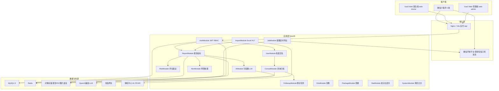
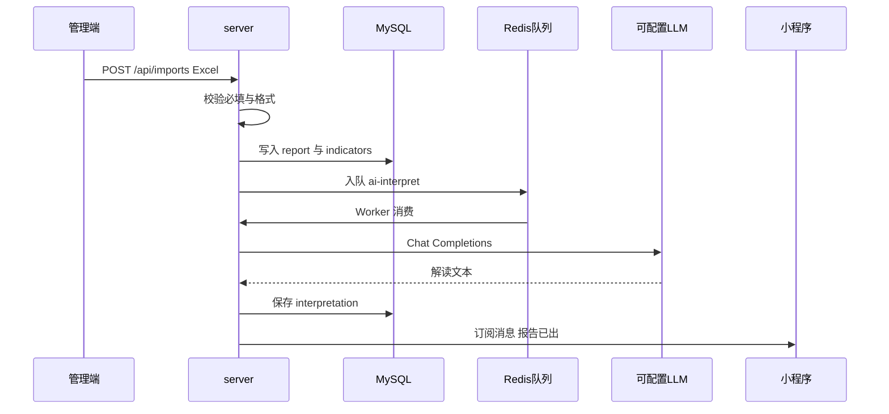
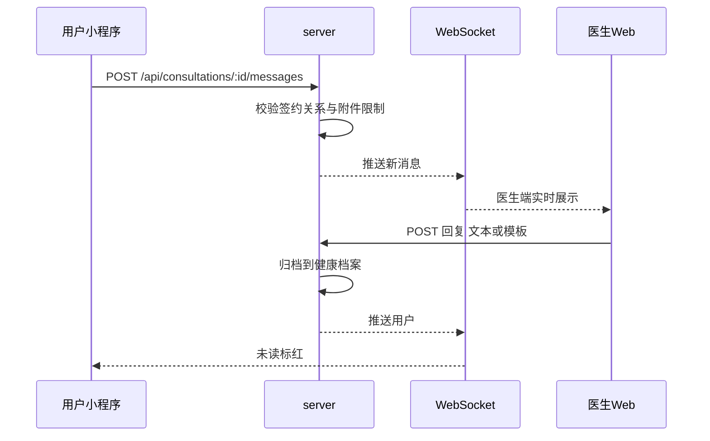

# 检后无忧全流程健康管理平台 技术设计

Feature Name: jianhou-wuyou-health-platform
Updated: 2026-10-09

## Description

本设计覆盖 C 端独立微信小程序、B 端医生 Web、B 端管理 Web 与统一后端。平台实现：体检数据导入与匹配、报告查看、可配置大模型解读、异常预警、在线咨询、复查提醒、健康打卡、随访与宣教、统计分析、RBAC 与审计。

AI 解读通过项目环境变量接入 OpenAI 兼容协议，默认对接通义千问兼容端点，运行时由 `USER_LLM_API_KEY`、`USER_LLM_BASE_URL`、`USER_LLM_MODEL` 决定实际模型，代码不绑定某一厂商。

对应需求：Requirement 1–35。

## Architecture

仓库按多工程拆分：C 端独立微信小程序，医生端与管理端为两个 Vue 3 工程，共用 `packages/` 中的组件与类型，后端统一 NestJS。

```
/workspace
  miniprogram/          微信原生小程序（C 端）
  web-doctor/           Vue 3 医生端 Web
  web-admin/            Vue 3 管理端 Web
  server/               NestJS API、定时任务、消息推送、AI 代理
  packages/shared/      指标状态、风险枚举、校验规则、DTO 类型
  packages/web-ui/      两端 Web 共用的脱敏、表格、上传、图表封装
```

### 逻辑架构



### 核心业务时序

**数据进入与解读**



**咨询闭环**



### 部署与预览

线上预览只暴露一个端口。默认暴露 `web-admin`（管理端）开发服务器，将 `/api` 反代到 `server`（默认 `http://127.0.0.1:3001`）。医生端 `web-doctor` 使用独立 Vite 端口（默认 5174），同样反代 `/api` 与 WebSocket；需要预览医生端时切换暴露端口。小程序开发者工具指向同一 API 的 HTTPS 域名；本地联调使用微信开发者工具「不校验合法域名」。

`web-doctor` 与 `web-admin` 的 Vite `server.allowedHosts` 均包含 `.monkeycode-ai.online`。两个前端工程独立登录、独立路由、独立构建产物，仅通过 `packages/shared` 与 `packages/web-ui` 复用类型、校验与通用组件。

## Components and Interfaces

### 1. 微信小程序 `miniprogram/`

原生微信小程序，独立工程，使用微信登录、手机号、订阅消息、分享卡片。

| 页面 | 路径 | 对应需求 |
| :--- | :--- | :--- |
| 授权登录 | pages/auth/login | R1 |
| 绑定手机 | pages/auth/bind-phone | R2 |
| 完善资料 | pages/auth/profile | R3 |
| 实名认证 | pages/auth/realname | R4 |
| 首页/报告列表 | pages/report/list | R5 |
| 报告详情 | pages/report/detail | R6 R9 |
| 报告解读 | pages/report/interpret | R8 |
| 下载分享 | pages/report/share | R7 |
| 风险评估 | pages/risk/index | R10 |
| 咨询会话 | pages/consult/chat | R11 R12 |
| 咨询列表 | pages/consult/list | R12 |
| 复查提醒落地 | pages/recheck/appoint | R13 |
| 健康打卡 | pages/health/log | R14 |
| 用药运动提醒 | pages/health/remind | R15 |

小程序请求头：`Authorization: Bearer <jwt>`。文件上传走 `wx.uploadFile` 至 `/api/files`。

订阅消息模板：报告就绪、复查前提醒、复查当天、用药/运动提醒、医生回复。用户需一次性订阅对应模板。

### 2. 医生端 Web `web-doctor/`

独立 Vue 3 + Vite + Pinia + Vue Router + Element Plus 工程，仅服务医生角色。登录接口校验角色为 `doctor`，其他角色返回 403。菜单固定为医生工作台，不渲染管理端功能。

**菜单：** 患者列表、健康档案、预警中心、咨询工作台、随访任务、健康宣教、处方模板。

| 路由 | 需求 |
| :--- | :--- |
| /login | R30 |
| /patients | R16 |
| /patients/:id | R17 签约校验 |
| /alerts | R19 R20 |
| /consult | R21 R22 |
| /followups | R23 |
| /edu | R24 |

开发端口默认 5174。敏感字段展示走 `packages/web-ui` 的 `maskName`、`maskPhone`、`maskIdNo`。咨询页连接 `/api/ws`。

### 3. 管理端 Web `web-admin/`

独立 Vue 3 工程，仅服务管理员角色。登录接口校验角色为 `admin`。菜单固定为运营与系统管理，不渲染医生工作台。

**菜单：** 数据导入、接口同步、套餐、统计/白皮书、用户与推送、角色权限、预警阈值、系统日志、评估模型配置。

| 路由 | 需求 |
| :--- | :--- |
| /login | R30 |
| /imports | R25 |
| /fhir | R26 |
| /packages | R27 |
| /stats | R28 |
| /users | R29 |
| /rbac | R30 |
| /logs | R31 |
| /settings/alerts | R19 |
| /settings/risk-model | R10 |

开发端口默认 5173（预览默认暴露此端口）。

两个 Web 工程共用同一套 Vite 反代配置：

```javascript
server: {
  allowedHosts: ['.monkeycode-ai.online'],
  proxy: {
    '/api': {
      target: 'http://127.0.0.1:3001',
      changeOrigin: true,
      ws: true
    }
  }
}
```

医生端与管理端 JWT 分端存储，互不共用 localStorage 键名（`jh_doctor_token` / `jh_admin_token`），避免同浏览器串端。

### 4. 后端模块 `server/`

NestJS + TypeScript，全局前缀 `/api`。JWT 鉴权 Guard + 权限装饰器 `@Roles('user'|'doctor'|'admin')` + 资源归属 Guard（签约关系、本人报告）。

#### HTTP API

| 方法 | 路径 | 角色 | 说明 |
| :--- | :--- | :--- | :--- |
| POST | /auth/wechat | 公开 | code 换 OpenID，签发 JWT |
| POST | /auth/sms/send | user | 发验证码，Redis TTL 300s |
| POST | /auth/sms/bind | user | 绑定手机，一号一账号 |
| PUT | /users/me/profile | user | 年龄性别病史过敏史 |
| POST | /users/me/realname | user | 实名并匹配报告 |
| GET | /reports | user | 分页 10，倒序 |
| GET | /reports/:id | user/doctor/admin | 详情+指标，权限分流 |
| GET | /reports/:id/pdf | user/doctor | 原始 PDF |
| POST | /reports/:id/interpret | user | 整体解读 |
| POST | /reports/:id/ask | user | 单项追问，日限额 10 |
| GET | /risk/me | user | 慢病风险+雷达五维 |
| POST | /consultations | user | 发起咨询 |
| GET | /consultations | user/doctor | 历史，医生筛选 |
| POST | /consultations/:id/messages | user/doctor | 文本/图片/语音 |
| GET | /health-logs | user/doctor | 打卡趋势 |
| POST | /health-logs | user | 血压血糖体重步数 |
| POST | /reminders | user | 用药运动提醒 |
| GET | /doctor/patients | doctor | 分页 20，筛选排序 |
| GET | /doctor/patients/:id/record | doctor | 档案时间轴 |
| GET | /doctor/patients/:id/record.pdf | doctor | 导出 PDF |
| POST | /doctor/groups | doctor | 分组 CRUD 与批量移动 |
| GET | /alerts | doctor/admin | 预警列表 |
| POST | /alerts/:id/handle | doctor | 标记处理/发起随访 |
| POST | /prescriptions | doctor | 处方模板与发送 |
| POST | /followups | doctor | 计划与批量 |
| POST | /followups/:id/result | doctor | 随访结果归档 |
| POST | /edu | doctor | 宣教发布 |
| GET | /edu/:id/stats | doctor | 阅读点赞评论 |
| POST | /admin/imports | admin | Excel/CSV |
| GET | /admin/imports/template | admin | 模板下载 |
| POST | /admin/fhir/ingest | 系统/admin | HL7/FHIR，支持续传 token |
| CRUD | /admin/packages | admin | 套餐上下架 |
| GET | /admin/stats | admin | 检出率异常率均值 |
| POST | /admin/stats/whitepaper | admin | 白皮书图表 |
| POST | /admin/stats/export | admin | PDF/Excel，可定时邮件 |
| GET | /admin/users | admin | 用户列表脱敏导出 |
| POST | /admin/push | admin | 分组订阅消息 |
| CRUD | /admin/roles | admin | RBAC 与继承 |
| GET | /admin/audit-logs | admin | 6 个月查询 |
| PUT | /admin/settings/alert-rules | admin | 预警阈值 |
| PUT | /admin/settings/risk-model | admin | 评估模型配置 |

WebSocket：`/api/ws`，JWT 查询参数鉴权，房间 `consult:{consultationId}`、`doctor:{doctorId}`。

#### AI 模块

`AiModule` 只依赖 OpenAI 兼容 `POST {USER_LLM_BASE_URL}/chat/completions`。

环境变量（写入 `server/.env.example`，由部署方填入真实值）：

```
USER_LLM_API_KEY=your-api-key-here
USER_LLM_BASE_URL=https://dashscope.aliyuncs.com/compatible-mode/v1
USER_LLM_MODEL=qwen-plus
```

Prompt 约束：

- 整体解读：输入报告摘要（科室、指标名、值、单位、参考范围、状态），输出通俗说明，末尾固定免责声明「AI建议仅供参考，不能替代医生诊断」。
- 单项追问：`你是一名全科医生，请根据用户的体检指标【{name} {value} {unit}，参考范围{range}】，用通俗易懂的语言回答用户问题【{question}】。回答需包含：可能原因、严重程度、生活建议。`
- 超时：调用 5 秒超时；超时返回业务码 `AI_TIMEOUT`，前端展示「AI正在思考，请稍后」，允许重试。
- 追问计数：Redis `ask:{userId}:{yyyyMMdd}`，上限 10。

### 5. 文件与消息

- 图片：单张 ≤ 5MB，单次咨询 ≤ 9 张，MIME 白名单 jpeg/png/webp。
- 语音：≤ 60 秒，格式 mp3/aac。
- 报告 PDF、宣教视频存 OSS，数据库只存对象键。
- 短信验证码：6 位，5 分钟 TTL；错误计数 Redis，满 3 次锁定 10 分钟。
- 复查提醒：医生建议复查日写入 `recheck_reminders`，定时任务在 D-3 与 D-0 各推一次订阅消息；点击跳转预约页。

## Data Models

MySQL InnoDB，utf8mb4。隐私字段 `phone`、`id_no` 应用层 AES-256-GCM 加密后存储，密钥来自 `USER_DATA_AES_KEY`。统计查询使用独立脱敏宽表或哈希索引字段 `id_no_hash`、`phone_hash`。

### 主要实体

**users**

| 字段 | 类型 | 说明 |
| :--- | :--- | :--- |
| id | bigint PK | |
| openid | varchar 64 unique | 微信 OpenID |
| nickname | varchar 20 | |
| avatar_url | varchar 512 | |
| phone_enc | varbinary | AES 手机号 |
| phone_hash | char 64 | 绑定唯一约束 |
| age | tinyint | 1-120 |
| gender | enum male/female | |
| medical_history | varchar 200 | |
| allergy_history | varchar 200 | |
| real_name_enc | varbinary | |
| id_no_enc | varbinary | |
| id_no_hash | char 64 | 匹配体检数据 |

**doctors / admins / roles / role_permissions / user_roles**

RBAC：角色可继承 `parent_role_id`。权限码示例：`report:self:read`、`patient:contracted:read`、`import:write`、`stats:read`。

**doctor_patient** 签约关系。医生仅能访问存在该行的患者。

**reports / indicators**

| reports | 说明 |
| :--- | :--- |
| id, user_id nullable | 未匹配用户时 user_id 空 |
| exam_date, org_name | |
| risk_level | low/mid/high |
| abnormal_count | |
| pdf_key, thumb_key | OSS |
| source | excel/fhir |
| ai_summary | 整体解读 |
| ai_disclaimer_shown | boolean |

| indicators | 说明 |
| :--- | :--- |
| report_id, name, value_text, unit, ref_range | |
| status | normal/high/low |
| department | 血常规/肝功能等 |

导入行按「身份证号哈希 + 体检日期 + 机构」聚合为报告，再拆指标行。

**ai_ask_logs**：user_id、report_id、indicator_name、question、answer、created_at。用于日限额与审计。

**risk_assessments**：五维分数 0-100，慢病条目 JSON，model_version。

**consultations / messages**

消息：sender_role user/doctor，type text/image/audio，content 或 file_key，status sent/unread/read。咨询结束后整表只读（`archived_at` 非空后 UPDATE 拒绝）。

**alert_rules**：指标编码、运算符、阈值、alert_level high/mid。默认：

- 血糖 > 11.1 mmol/L → high
- 血压收缩压 > 160 或舒张压 > 100 → high
- 谷丙转氨酶 > 100 U/L → mid
- 总胆固醇 > 7.0 mmol/L → mid

**alerts**：report_id、patient_id、level、status open/handled、handled_by、handled_at、handle_method。

**followup_plans / followup_tasks / followup_results**

周期 monthly/quarterly；任务 due_date，逾期 UI 标红；结果归档到档案时间轴。

**patient_groups / patient_group_members**

**health_logs**：type bp/glucose/weight/steps，value JSON（血压含收缩/舒张），abnormal 标记。血压收缩压 > 180 时 abnormal=true。

**reminders**：type medication/exercise，rrule daily/weekly，next_fire_at。

**packages**：name、price、crowd、status on/off，items 关联指标库。下架后小程序列表过滤 `status=on`，已预约订单保留。

**edu_posts / edu_stats**

**import_batches / import_rows**：row_no、status、error_message，失败行可导出。

**fhir_cursors**：source_system、resume_token、last_success_at。

**audit_logs**：actor_id、action、payload、ip、created_at。保留 180 天，分区表按月。

**share_cards**：report_id、mini_code_url。

## Correctness Properties

1. 一个 `phone_hash` 只绑定一个 user。
2. 用户只能读取 `reports.user_id = 当前用户` 的报告。
3. 医生读取报告/档案当且仅当存在 `doctor_patient` 且状态有效。
4. 管理员可读取全部报告，列表对外展示一律脱敏。
5. 验证码错误满 3 次后 10 分钟内拒绝新的 bind 请求。
6. 单项追问同一自然日同一用户 ≤ 10。
7. 咨询单次图片 ≤ 9 且每张 ≤ 5MB，语音 ≤ 60s。
8. 咨询 `archived_at` 非空后消息不可更新。
9. 预警标记 handled 后从 open 列表消失，处理日志字段齐全。
10. 导入失败必须带行号；成功批次触发 AI 任务。
11. FHIR 中断后续传使用同一 `resume_token` 不重复插入（幂等键：源系统消息 ID）。
12. 套餐下架后新用户不可见，既有预约状态保持。
13. 审计日志保留不少于 180 天。
14. 隐私列不以明文落库；统计任务读脱敏数据。
15. 常规接口 500 并发平均响应 ≤ 2s；AI 调用客户端等待 ≤ 5s。
16. JWT 过期或权限码不匹配时返回 401/403，不泄露资源是否存在（医生访问非签约患者返回 403）。

## Error Handling

| 场景 | HTTP | 业务码 | 用户可见文案 |
| :--- | :--- | :--- | :--- |
| 拒绝微信授权 | 前端 | WECHAT_AUTH_DENIED | 请允许授权以使用完整功能 |
| 验证码错误 | 400 | SMS_CODE_INVALID | 验证码错误 |
| 验证码锁定 | 429 | SMS_LOCKED | 尝试次数过多，请 10 分钟后重试 |
| 手机号已占用 | 409 | PHONE_TAKEN | 该手机号已被占用 |
| 年龄非法 | 400 | AGE_INVALID | 请输入有效年龄 |
| 身份证格式错误 | 400 | IDNO_INVALID | 身份证号格式错误 |
| 未匹配体检记录 | 404 | REPORT_NOT_MATCHED | 未找到您的体检记录，请联系客服 |
| 未签约医生 | 409 | NO_CONTRACT | 请先签约医生后再发起咨询 |
| 追问超额 | 429 | ASK_LIMIT | 当日追问次数已用完 |
| AI 超时 | 504 | AI_TIMEOUT | AI正在思考，请稍后 |
| 附件超限 | 400 | FILE_LIMIT | 图片或语音超出限制 |
| 导入行失败 | 200+明细 | IMPORT_ROW_FAIL | 指出行号，支持导出失败行 |
| 越权 | 403 | FORBIDDEN | 无权限 |
| PDF 生成失败 | 500 | PDF_FAIL | 下载失败，请重试 |
| LLM 未配置 | 503 | LLM_NOT_CONFIGURED | 解读服务暂不可用 |

全局异常过滤器记录审计（脱敏），5xx 对客户端隐藏堆栈。

导入采用「行级事务」：合法行提交，非法行进入 `import_rows` 失败列表。整批结束后对成功报告异步触发 AI。

微信订阅消息失败写入 `push_failures` 并有限次重试（最多 3 次，指数退避）。

## Test Strategy

### 单元测试

- 身份证 18 位校验、年龄 1-120、手机号 11 位 1 开头。
- 指标状态：值相对参考范围得到 high/low/normal，箭头与颜色映射。
- 预警规则引擎：默认四条阈值与可配置规则。
- 风险模型：给定年龄/性别/指标 fixture，输出等级与五维分数稳定。
- 脱敏函数、AES 加解密往返、RBAC 继承解析。
- Prompt 组装：指标名、值、单位、范围、问题完整进入模板。

### 接口测试

- 鉴权矩阵：用户/医生/管理员对各 API 的允许与拒绝（对齐需求权限表）。
- 报告分页 10、患者分页 20、风险色标。
- 短信：TTL、错误 3 次锁定、一号一账号。
- 追问日限额跨日重置。
- 咨询附件边界：第 10 张图拒绝、5MB+1 拒绝、61 秒语音拒绝。
- 导入：缺必填行列出行号；成功行生成报告并入队 AI。
- FHIR 续传：中断后重放不产生重复报告。
- 预警处理：handled 后列表消失且日志完整。
- 套餐下架：列表不可见、预约仍可查询。

### 契约与端到端

- 小程序关键路径：授权 → 绑手机 → 资料 → 列表 → 详情 → 解读 → 追问 → 咨询。
- 医生路径：登录 → 患者 → 档案脱敏 → 预警处理 → 回复 → 随访记录。
- 管理路径：下载模板 → 导入 → 统计导出。
- WebSocket：医生回复后用户端 2 秒内收到。

### 性能与安全

- JMeter：500 并发读报告列表，平均 ≤ 2s。
- AI 接口单独压测，超时策略生效。
- 依赖扫描与 OWASP ZAP 对 Web/API；无高危。
- 前端 XSS：富文本宣教消毒；SQL 全部参数化。

### 兼容

- 微信最新版基础库真机：主流 iOS/Android 屏幕。
- Web：Chrome / Edge / Safari 最近两个大版本。

## Implementation Notes

1. 当前仓库为 Vue 3 TaskHub 模板，实施时新建 `miniprogram/`、`web-doctor/`、`web-admin/`、`server/`、`packages/`，模板页可废弃或替换为管理端入口。
2. C 端保持微信小程序独立工程。预览默认暴露 `web-admin`；医生端 `web-doctor` 独立端口独立构建。小程序用开发者工具对接 API。
3. 大模型 Key、Base URL、模型名只来自项目 `.env`，使用 `USER_LLM_*` 变量名。
4. 一期即可并行三端接口契约；页面可按需求优先级分批交付，契约保持稳定。
5. 雷达图、白皮书使用 ECharts；小程序端使用 echarts-for-weixin。

## References

- 产品需求原文与本目录 `requirements.md`（Requirement 1–35）
- 微信小程序登录、订阅消息、分享能力官方文档
- OpenAI Compatible Chat Completions
- HL7 FHIR R4 患者与观察资源
- INCOSE / EARS 需求写法（本目录 requirements.md）
